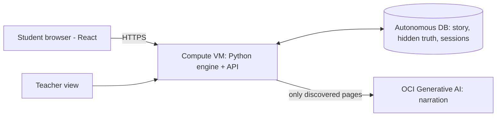

# The Stolen Hours of the Monkey King — Game Design Doc

Oct 17, 2026 · @Siddiq

## 1. Summary

The Stolen Hours of the Monkey King is a reasoning game for children aged 8 to 13. It answers Challenge #3, "AI That Strengthens Learning." The AI narrator never knows the answer, so it cannot do the thinking for the child.

| Item | Decision |
| --- | --- |
| Product | An AI storytelling platform that turns myths into reasoning adventures |
| Demo myth | Journey to the West (public domain, about 430 years old) |
| Player | The Seeker, a village child. The player is NOT Wukong. |
| Narrator | The Torn Scroll (OCI Generative AI). It knows only the pages the player finds. |
| Goal | Find who stole the hours. Rebuild a broken timeline from clues in the environment. Beat Sun Wukong in a duel of evidence. |
| Unpredictable part | At the start, the game engine picks 1 of 3 hidden story variants. Each variant has a different culprit. |
| Proof of learning | A teacher view measures reasoning, not completion |
| Play time | About 15 minutes |
| Hook | "An AI narrator that cannot cheat for you, and a Monkey King who lies to you." |

**Three design rules that stop the CATEX traps:**

1. The game engine (fixed Python rules) makes every decision. The AI only narrates and gives hints. We never tune the AI for accuracy.
2. The story locks at 1:00 PM Saturday. After that, we add no new story content.
3. An ugly but complete game must work by 5:00 PM Saturday. Polish comes after.

## 2. Story bible

The story is original. Only the characters come from Journey to the West and Chinese folklore, which are public domain. We use no names, plot, art or music from Black Myth: Wukong, and we do not mention that game in the pitch.

### Prologue (watch only, 30 seconds, 5 lines)

1. "Five hundred years ago, a stone monkey learned 72 magic changes."
2. "He called himself Sun Wukong, the Monkey King, and he fought all of Heaven."
3. "Heaven trapped him under Five Elements Mountain."
4. "Today, the mountain is shaking. Morning comes before night. Fruit rots before it grows."
5. "Someone broke the Hourglass of Seasons. Six Memory Pearls are lost. Seeker, find them."

### World

- **Village at the foot of Five Elements Mountain:** the start screen and the realm map.
- **Bamboo Forest:** the mountain shrine where the Hourglass of Seasons stood. Time clue: shadows.
- **East Sea shore:** home of the Dragon King. Time clue: tides.
- **Moon Palace stairs:** home of the Jade Rabbit. Time clue: the moon.

### Characters

| Character | Role | Personality | Source |
| --- | --- | --- | --- |
| The Seeker | Player, a village child | Curious, brave | Original |
| Grandmother Lin | Village elder, gives the player the Torn Scroll | Calm, wise | Original |
| The Torn Scroll | AI narrator and guide | Kind, asks questions, admits torn pages | Original |
| Sun Wukong | Final duel opponent, trickster tester | Funny, proud, tricky, never cruel | Journey to the West |
| Jade Rabbit | Suspect | Shy, loves the Moon Festival | Chinese folklore |
| Dragon King of the East Sea | Suspect | Grumpy, loves rain | Journey to the West |

### The three hidden variants

The engine picks one variant when a new game starts. The player never sees which one.

| Variant | Culprit | Motive (kid-safe) | Sign the culprit left |
| --- | --- | --- | --- |
| V1 | Sun Wukong | He wanted one more free day at the Peach Festival. | A golden hair, cloud-somersault tracks |
| V2 | Jade Rabbit | She wanted the full moon of the Moon Festival to last forever. | White paw prints, rice-cake crumbs |
| V3 | Dragon King | He wanted the rainy season to never end. | A puddle on a dry day, frost melted into rain |

**Wukong's role in every variant:** he is always the final duel opponent. He breaks his seal and says, "Only a wise child can fix the hourglass. Prove it, little Seeker!" He uses his 72 changes to take the shape of the suspects and tell lies. He is a tester, not a monster.

### Tone rules

- No death, no blood, no fear scenes.
- The duel is a staff clash animation. Every hit comes from a correct answer.
- No character is fully bad. Every culprit has a reason a child can understand.
- Main lesson: do not judge before you see the evidence. The obvious suspect (Wukong) is wrong in 2 of 3 variants.

## 3. Gameplay design

The player explores 3 realms, finds 6 Memory Pearls, puts them in time order, and then beats Wukong in 3 duel rounds of evidence. The player never loses; a wrong answer gives a hint and another try.

### Core loop (one game)

1. **Prologue:** the player watches 5 lines. Grandmother Lin gives the Torn Scroll.
2. **Realm map:** the player picks a realm. All 3 realms are open, in any order.
3. **In a realm:** the player uses 4 actions to investigate.
4. **Predict first:** before a pearl opens, the player picks what they think it will show (3 choices).
5. **Pearl opens:** the player sees the memory. The engine stores the prediction result.
6. **Repeat** until the player has all 6 pearls.
7. **Timeline board:** the player drags the 6 pearls into time order.
8. **Duel with Wukong:** 3 rounds.
9. **Final verdict:** the player names the culprit and attaches 2 pearls as proof.
10. **Ending:** 1 of 3 endings plays. Then the player writes the next legend chapter.

### Realm actions

| Action | What it does | Example in the Bamboo Forest |
| --- | --- | --- |
| Look | Shows a detail in the scene | "The bamboo shadows are very long." |
| Listen | Shows a sound | "Wind chimes ring at the shrine." |
| Ask the Scroll | Free-text chat with the AI narrator | "Why are the shadows long?" |
| Open pearl | Starts predict-first, then reveals | Unlocks after Look and Listen |

**Unlock rule:** a pearl opens only after the player uses Look AND Listen in that realm. This makes the player observe before they get information.

### Time clues (there are no clocks in the game)

| Realm | Clue | Science the child uses |
| --- | --- | --- |
| Bamboo Forest | Shadow length and direction | Long shadows = early or late in the day. Shortest shadow = midday. |
| East Sea | Tide level | Wet sand far out = low tide. Water at the stone line = high tide. |
| Moon Palace | Moon position | A full moon rises at sunset. It is highest at about midnight. |

### Timeline board rules

- The board has 6 empty slots from "first" to "last."
- The player drags the pearls into the slots and presses "Check."
- The engine compares the order with the true order.
- All correct: the board glows and the duel starts.
- Wrong: the engine finds the first pair in the wrong order. The Scroll asks a question about those 2 pearls. It does not say which pearl is wrong.

### Duel rules

- Wukong has 3 magic hairs. Each round, he plucks one hair and changes into a suspect.
- The form makes one claim. The player picks "Truth" or "Lie" and picks 1 pearl as proof.
- Correct: a staff clash animation plays, and Wukong loses the hair.
- Wrong: Wukong makes a copy of himself and laughs. The Scroll gives the next hint. The player tries again.
- Round 1: the lie disagrees with one pearl.
- Round 2: the claim is TRUE. This tests whether the player trusts evidence over suspicion.
- Round 3: the lie disagrees with the ORDER of two pearls. Only a correct timeline catches it.

### Hint ladder (same for every puzzle)

| Level | Type | Example |
| --- | --- | --- |
| 1 | Open question | "What does the sun do in the morning?" |
| 2 | Narrow question | "Where is the sun at dawn: east or west?" |
| 3 | Near answer | "Morning shadows are the longest. Which pearl has the longest shadows?" |

The Scroll never gives the answer itself. After level 3, the player still must make the choice.

## 4. Content sheet

This is all the story text the game needs: 6 shared pearls, 6 variant lines, 5 duel claims, 3 endings. Load it into SQL by 1:00 PM. Edit words here, not in code.

### Memory Pearls (true order = 1 to 6)

| # | Realm | Time | Pearl text (shared) | Time clue |
| --- | --- | --- | --- | --- |
| P1 | Bamboo Forest | Dawn | The sun is just rising. Long bamboo shadows stretch across the path. The Hourglass of Seasons glows, whole and bright, on the shrine. | Long shadows |
| P2 | Bamboo Forest | Midday | The bamboo has almost no shadow. A thin crack runs across the hourglass. \[variant sign\] | No shadow |
| P3 | East Sea | Afternoon | The sea is far out. Wet sand and stranded shells cover the beach. Sharp, glowing glass sand sparkles by the rocks. | Low tide |
| P4 | East Sea | Sunset | The water reaches the high stone line. The sun touches the sea. A trail of glowing glass sand leads up toward the sky stairs. | High tide, sunset |
| P5 | Moon Palace | Moonrise | A huge full moon sits low on the edge of the sky. \[variant sign\] | Low full moon |
| P6 | Moon Palace | Midnight | The full moon is straight overhead. The last grain of glowing time falls. The broken hourglass is empty. | Moon overhead |

### Variant signs (added to P2 and P5)

| Variant | P2 sign | P5 sign |
| --- | --- | --- |
| V1 Wukong | A single golden hair lies by the shrine. | Cloud tracks curl in a somersault shape on the stairs. |
| V2 Jade Rabbit | Small white paw prints circle the shrine. | Rice-cake crumbs lie on every step. |
| V3 Dragon King | A puddle sits by the shrine, but no rain fell today. | The frost on the stairs has melted into rain drops. |

### Predict-first choices (one per pearl)

| Pearl | Question | Choices (correct first, shuffled on screen) |
| --- | --- | --- |
| P1 | The forest has long shadows. What time is it? | Early morning · Midday · Midnight |
| P2 | There is almost no shadow. What time is it? | Midday · Dawn · Sunset |
| P3 | The sea is far out. What do you expect on the sand? | Wet sand and shells · Dry sand · Deep water |
| P4 | The sun touches the sea. What will the tide be? | Up at the stone line · Far out · No water |
| P5 | A full moon sits low. What just happened? | The sun just set · It is noon · It is dawn |
| P6 | The moon is straight overhead. What time is it? | About midnight · Sunset · Morning |

### Duel claims

| Round | Variant | Wukong's form | Claim | Answer | Proof pearl |
| --- | --- | --- | --- | --- | --- |
| 1 | V1 | Himself | "I stayed under my mountain all day." | Lie | P2 |
| 1 | V2 | Jade Rabbit | "I never left the moon all day." | Lie | P2 |
| 1 | V3 | Dragon King | "I stayed under the sea. It was a dry day." | Lie | P2 |
| 2 | All | The suspect who is NOT the culprit | "The full moon rose just as the sun set." | Truth | P4 or P5 |
| 3 | All | Himself | "The sea broke the hourglass. The glass sand on the beach came first, and the crack came later." | Lie | P2 (crack at midday is before P3, the afternoon sand) |

### Final verdict

The player names the culprit and attaches P2 and P5. Both pearls hold the variant sign, so the evidence is complete.

### Endings

| Variant | Ending text |
| --- | --- |
| V1 | Wukong laughs and bows. "You caught me, little Seeker! I only wanted one more peach festival." He gives back the hours, and the hourglass is whole again. As a gift, he teaches the Seeker one of his 72 changes. |
| V2 | The Jade Rabbit steps out, ears down. "I only wanted the Moon Festival to last." Wukong grins. "I hid her tracks to test you. You did not blame the obvious monkey!" The Rabbit returns the hours, and the village plans a festival together. |
| V3 | The Dragon King rises from the sea, dripping. "My sea was thirsty." Wukong says, "I shook my own mountain to warn the village, and everyone blamed me. You looked at the evidence." The Dragon returns the hours, and the rain falls only in its season. |

### Creative finish (all variants)

The Scroll says: "A new legend needs a writer. What does Wukong do next?" The child writes the next chapter. The Scroll asks up to 3 questions to help ("Where does he go? Who does he meet? What problem must he solve?"). The Scroll never writes the chapter.

## 5. Critical thinking and the teacher view

Each game mechanic trains one thinking skill, and the game records one number for each skill. This is our evidence that the game builds understanding, not just task completion, which Challenge #3 asks for.

| Thinking skill | Mechanic that trains it | Number the game records |
| --- | --- | --- |
| Observation | Look and Listen before a pearl opens | Actions used before each pearl |
| Inference from evidence | Time clues with no clocks | Predict-first accuracy (out of 6) |
| Sequencing and cause | Timeline board | Correct on the first try (yes or no), number of tries |
| Spotting contradictions | Duel rounds 1 and 3 | Correct with the right proof pearl (out of 2) |
| Trusting evidence over bias | Duel round 2 (true claim) | Passed the trust test (yes or no) |
| Independence | Hint ladder | Hints used (0 to 3 per puzzle) |
| Creativity | Write the next legend chapter | Chapter length in words (we do not grade quality) |

### Teacher view (one screen)

- It shows class totals only. It shows no student names, only nicknames.
- Five cards: average predict-first accuracy, percentage of students who got the timeline right on the first try, duel proof accuracy, percentage who passed the trust test, average hints used.
- One bar chart: hints used for each puzzle. It shows the teacher which concept is hardest (for example, tides).

**Pitch line:** "We do not measure if students finish. We measure if they reason."

## 6. UI, UX and art direction

The look is an ink-wash storybook: rice-paper background, black ink, one red accent. We need no artists: we use free photos with a CSS ink filter, public-domain prints, and shapes that code draws.

### Visual style

| Item | Choice |
| --- | --- |
| Background | Rice paper cream #F4EDE0 |
| Text | Ink black #1C1B19 |
| Main accent | Cinnabar red #B23A2B (buttons, Wukong) |
| Second accent | Jade green #3E7C6B (correct answers) |
| Pearl glow | Gold #E2B44C |
| Title font | "Cinzel" from Google Fonts |
| Body font | "Nunito" from Google Fonts, 18 px minimum (easy for children to read) |
| Scenery filter | CSS: grayscale 0.7, sepia 0.3, contrast 1.2 |

### Screens (10 total)

| # | Screen | Layout | Main interaction |
| --- | --- | --- | --- |
| 1 | Title | Mountain image, title, "Begin" button, nickname box | Type a nickname |
| 2 | Prologue | Full-screen image, lines fade in one by one | Tap to continue |
| 3 | Realm map | 3 realm cards in a row, pearl counter (0 of 6) | Pick a realm |
| 4 | Realm scene | Image on the left (60%), Scroll chat on the right (40%), 4 action buttons under the image | Look, Listen, Ask, Open pearl |
| 5 | Predict first | Pearl in the center, 3 choice buttons | Pick a prediction |
| 6 | Pearl reveal | Pearl grows and shows the memory text | Tap to keep |
| 7 | Timeline board | 6 pearl cards above, 6 slots below | Drag and drop, "Check" |
| 8 | Duel | Wukong image center, 3 hair icons, claim bubble, Truth/Lie buttons, pearl picker | Answer, attach proof |
| 9 | Ending and legend | Ending text, then a writing box with Scroll questions | Write a chapter |
| 10 | Teacher view | 5 number cards, 1 bar chart | Read only |

On a phone, the realm scene stacks: image on top, chat below.

### Image sources (Tarik, 45 minutes maximum)

- **Scenery:** Unsplash or Pexels photos of a bamboo forest, a rocky sea shore, a full moon, and a misty mountain. Check each license.
- **Wukong and myth characters:** public-domain Journey to the West prints on Wikimedia Commons, for example Yoshitoshi's Monkey King woodblock prints. Use only files marked "public domain."
- **Never use** Black Myth: Wukong art or screenshots.
- Write every image's source link in the README.

### Motion (CSS only, 0.3 to 0.6 seconds)

- Pearl: soft gold glow pulse.
- Correct duel answer: a screen shake, and one hair icon fades out.
- Wukong's change: fade out, then fade in as the new form.
- Scenery: a slow zoom of 5% over 20 seconds.
- Wrong answer: a gentle wobble. No red "X" and no buzzer sound.

### UX rules for children

- One main action per screen.
- Every button has a word, not only an icon.
- Every Scroll message is 3 sentences or fewer.
- No timers. No "game over."

## 7. System architecture on OCI

All game parts run on Oracle Cloud: one VM for the engine, one Autonomous Database for the story and play data, and Generative AI for narration. The engine stands between the database and the AI, so the hidden truth cannot reach the AI.



| OCI part | What it does | Setup note |
| --- | --- | --- |
| Compute VM | Runs FastAPI and serves the HTML page | Open port 80 in the security list |
| Autonomous Database | Holds the 13 tables in section 8 | Connect with the wallet and python-oracledb thin mode |
| Generative AI | Writes Scroll and Wukong lines | Use a chat model available in your region; keep the model id in an environment variable |
| (Optional) Object Storage | Holds scenery images | Only if the VM disk is a problem; otherwise serve images from the VM |

**One request, step by step:** the child asks the Scroll a question → the browser sends it to the VM → the engine reads the opened pearls from the database → the engine sends only those pages to Generative AI → the reply returns to the child, and the engine logs it.

## 8. Database schema (Oracle Autonomous DB)

The database has 6 story tables that we load once and 7 play tables that fill during play. The `variants` and `duel_rounds` answer columns hold the hidden truth; the code never sends them to the AI.

```sql
-- STORY TABLES (load once from the content sheet)
CREATE TABLE variants (
  variant_id   VARCHAR2(4) PRIMARY KEY,      -- 'V1','V2','V3'
  culprit      VARCHAR2(40) NOT NULL,        -- HIDDEN: never sent to AI
  ending_text  CLOB NOT NULL
);

CREATE TABLE realms (
  realm_id     VARCHAR2(10) PRIMARY KEY,     -- 'bamboo','sea','moon'
  name         VARCHAR2(40),
  image_url    VARCHAR2(400),
  look_text    VARCHAR2(400),
  listen_text  VARCHAR2(400)
);

CREATE TABLE pearls (
  pearl_id     VARCHAR2(4) PRIMARY KEY,      -- 'P1'..'P6'
  realm_id     VARCHAR2(10) REFERENCES realms,
  true_order   NUMBER(1) NOT NULL,           -- HIDDEN: 1..6
  time_label   VARCHAR2(20),
  shared_text  VARCHAR2(600) NOT NULL,
  predict_q    VARCHAR2(200),
  predict_ok   VARCHAR2(100),
  predict_no1  VARCHAR2(100),
  predict_no2  VARCHAR2(100)
);

CREATE TABLE pearl_signs (                   -- variant signs for P2 and P5
  pearl_id     VARCHAR2(4) REFERENCES pearls,
  variant_id   VARCHAR2(4) REFERENCES variants,
  sign_text    VARCHAR2(300),
  PRIMARY KEY (pearl_id, variant_id)
);

CREATE TABLE duel_rounds (
  round_no     NUMBER(1),
  variant_id   VARCHAR2(4),                  -- 'ALL' for shared rounds
  form_name    VARCHAR2(40),
  claim_text   VARCHAR2(400),
  is_lie       NUMBER(1),                    -- HIDDEN
  proof_pearls VARCHAR2(20),                 -- HIDDEN, e.g. 'P4,P5'
  PRIMARY KEY (round_no, variant_id)
);

CREATE TABLE hints (
  puzzle_key   VARCHAR2(20),                 -- 'P1'..'P6','TIMELINE','R1'..'R3'
  level_no     NUMBER(1),
  hint_text    VARCHAR2(300),
  PRIMARY KEY (puzzle_key, level_no)
);

-- PLAY TABLES (fill during play)
CREATE TABLE sessions (
  session_id   VARCHAR2(36) PRIMARY KEY,     -- UUID
  nickname     VARCHAR2(30),
  variant_id   VARCHAR2(4) REFERENCES variants,  -- random at start
  hairs_left   NUMBER(1) DEFAULT 3,
  stage        VARCHAR2(20) DEFAULT 'prologue',
  started_at   TIMESTAMP DEFAULT SYSTIMESTAMP
);

CREATE TABLE actions_log (
  session_id   VARCHAR2(36) REFERENCES sessions,
  realm_id     VARCHAR2(10),
  action       VARCHAR2(10),                 -- 'look','listen','ask'
  at_time      TIMESTAMP DEFAULT SYSTIMESTAMP
);

CREATE TABLE unlocks (
  session_id   VARCHAR2(36) REFERENCES sessions,
  pearl_id     VARCHAR2(4) REFERENCES pearls,
  predicted_ok NUMBER(1),
  PRIMARY KEY (session_id, pearl_id)
);

CREATE TABLE timeline_tries (
  session_id   VARCHAR2(36) REFERENCES sessions,
  try_no       NUMBER(2),
  order_given  VARCHAR2(30),                 -- 'P1,P2,P3,P4,P5,P6'
  is_correct   NUMBER(1)
);

CREATE TABLE duel_answers (
  session_id   VARCHAR2(36) REFERENCES sessions,
  round_no     NUMBER(1),
  try_no       NUMBER(2),
  said_lie     NUMBER(1),
  proof_pearl  VARCHAR2(4),
  is_correct   NUMBER(1)
);

CREATE TABLE hint_uses (
  session_id   VARCHAR2(36) REFERENCES sessions,
  puzzle_key   VARCHAR2(20),
  level_no     NUMBER(1)
);

CREATE TABLE verdicts (
  session_id   VARCHAR2(36) REFERENCES sessions,
  named        VARCHAR2(40),
  proof        VARCHAR2(20),
  is_correct   NUMBER(1),
  legend_text  CLOB
);
```

**Load order:** variants → realms → pearls → pearl\_signs → duel\_rounds → hints. Write the inserts as one `seed.sql` file in the repo.

## 9. Game engine logic

> **Note:** the live API is the one in Shared Contract v1 (`/game/start`, `/game/action`, `GET /game/{id}`). The endpoints below describe the game logic. Build them as engine handlers behind the contract, not as new routes.

The engine is a small FastAPI app in Python. It owns every decision: it picks the variant, unlocks pearls, checks the timeline, judges the duel, and picks the ending. The AI is called only to write narration text.

### API endpoints

| Method | Path | Does | Returns |
| --- | --- | --- | --- |
| POST | /api/start | Makes a session, picks a random variant | session\_id |
| POST | /api/action | Logs Look or Listen in a realm | Scene text, can\_open\_pearl |
| POST | /api/ask | Sends a child's question to the Scroll | Scroll reply |
| POST | /api/predict | Stores the prediction, opens the pearl | Pearl text with variant sign |
| POST | /api/timeline | Checks an order of 6 pearls | correct, hint for the first wrong pair |
| GET | /api/duel/{round} | Gets the claim for this round | Form name, claim text |
| POST | /api/duel | Checks Truth/Lie plus proof | correct, hairs\_left, taunt or hint |
| POST | /api/verdict | Checks the culprit and 2 proof pearls | correct, ending text |
| POST | /api/legend | Saves the child's chapter | Next Scroll question |
| GET | /api/teacher | Class totals | 5 numbers, hints per puzzle |

### Core rules (Python)

```python
import random, uuid

TRUE_ORDER = ["P1", "P2", "P3", "P4", "P5", "P6"]

def start_game(nickname):
    variant = random.choice(["V1", "V2", "V3"])     # the unpredictable part
    sid = str(uuid.uuid4())
    db.insert_session(sid, nickname, variant)
    return sid

def can_open_pearl(sid, realm):
    done = db.actions_in_realm(sid, realm)          # set of actions
    return {"look", "listen"} <= done

def pearl_text(sid, pearl_id):
    s = db.session(sid)
    p = db.pearl(pearl_id)
    sign = db.sign(pearl_id, s.variant_id)          # None for P1, P3, P4, P6
    return p.shared_text.replace("[variant sign]", sign or "")

def check_timeline(order):
    if order == TRUE_ORDER:
        return {"correct": True}
    for a, b in zip(order, order[1:]):              # first pair out of order
        if TRUE_ORDER.index(a) > TRUE_ORDER.index(b):
            return {"correct": False, "pair": [a, b]}

def check_duel(sid, round_no, said_lie, proof):
    s = db.session(sid)
    r = db.duel_round(round_no, s.variant_id) or db.duel_round(round_no, "ALL")
    ok = (said_lie == r.is_lie) and (proof in r.proof_pearls.split(","))
    if ok:
        db.lose_hair(sid)
    return ok

def check_verdict(sid, named, proof_pair):
    v = db.variant(db.session(sid).variant_id)
    return named == v.culprit and set(proof_pair) == {"P2", "P5"}
```

### What the AI receives (and what it never receives)

| Sent to the AI | Never sent to the AI |
| --- | --- |
| Current realm name and its Look/Listen text if used | `culprit`, `true_order`, `is_lie`, `proof_pearls` |
| Text of pearls already opened by this player | Pearls not yet opened |
| The child's question | Other players' data |
| The current hint level text (when a hint is due) | The variant id |

The hint text comes from the `hints` table, written by us. The AI only says it in the Scroll's voice. This keeps every hint correct.

## 10. AI prompts

The game uses two prompts on OCI Generative AI: one for the Torn Scroll and one for Wukong's taunts. Settings for both: temperature 0.3, maximum 120 output tokens. If the AI call fails or takes more than 6 seconds, the game uses a pre-written line instead.

### Torn Scroll system prompt

```text
You are the Torn Scroll, an old magic scroll in a story for children aged 8 to 13.
Many of your pages are torn. You only know the facts in KNOWN PAGES below.

RULES
1. Use only facts from KNOWN PAGES and SCENE. Never add new facts, people, or events.
2. If the child asks about something not in KNOWN PAGES, say:
   "That page is torn. What could we look at to find out?"
3. Never say who broke the hourglass, the order of the pearls, or if a claim is true.
4. If HINT is given, say that hint in your own kind words. Do not make it stronger.
5. Use 3 short sentences or fewer. Use simple words.
6. End with one question that makes the child think.
7. Be warm. Never call an answer stupid. Never use scary words.

SCENE: {realm_name} - {scene_text}
KNOWN PAGES: {opened_pearl_texts}
HINT: {hint_text_or_none}
```

### Wukong taunt prompt

```text
You are Sun Wukong, the playful Monkey King, in a children's game.
Write ONE line (under 20 words) to the child, the Seeker.
EVENT: {event}          # "correct" or "wrong"
FORM: {form_name}
RULES: Be funny and proud, never mean. Do not reveal any answer.
Do not mention the claim's truth. No scary words.
```

### Fallback lines (used when the AI does not answer)

| Moment | Line |
| --- | --- |
| Scroll, no hint | "Hmm, my pages rustle. What do you notice in this place?" |
| Scroll, hint due | Say the `hints` table text exactly. |
| Wukong, correct | "Sharp eyes, little Seeker! There goes another hair!" |
| Wukong, wrong | "Ha! One more of me! Look again at your pearls." |

### Example exchange

- **Child:** "Who broke the hourglass?"
- **Scroll:** "That page is torn, little Seeker. But you found a pearl with a crack in it. What else did you see near the crack?"

## 11. Child safety and responsible AI

The game collects no personal data, the AI never decides anything, and the AI cannot do the child's thinking. These answer the challenge's "responsible innovation" rules.

| Challenge requirement | What we do |
| --- | --- |
| Synthetic or public data | All story data is ours. Myths are public domain. No real student data in the demo. |
| Say when AI is assisting | A small "AI narrator" label sits on every Scroll and Wukong message. |
| Say what informs the AI | A "How the Scroll works" button: "The Scroll only knows the pages you found." |
| Learners keep decision authority | The child makes every prediction, order, duel answer, and verdict. The AI cannot. |
| Privacy | Nickname only. No email, no age, no location, no logins. Teacher view shows totals. |
| Bias and fairness | No character is evil. The obvious suspect is wrong in 2 of 3 variants. |
| Human oversight | Teachers see the class numbers. All AI hints come from our written hint table. |

**Extra safety steps:**

- Input filter: a child's question longer than 200 characters is cut. A short block list stops rude words before the AI call.
- Output check: if the Scroll's reply names the culprit word for this variant, the game replaces the reply with the fallback line. This is one fixed string check, not tuning.
- Children under 13: because we store no personal information, the demo avoids collecting data from children (likely; not legal advice).

## 12. Team, schedule, cut list and fallbacks

Three roles, one owner each, and a hard checkpoint every 2 hours. If a checkpoint is late by more than 30 minutes, we use the cut list at once.

### Roles

| Person | Owns (from Shared Contract v1) | Done means |
| --- | --- | --- |
| Tarik | Integration: React pages, HTTP API, engine handlers for `order`, `answer`, `accuse`, the turn order AI → validation → events → persistence → narration, PR merges | A player can go from start to ending through the API |
| Taseen | Persistence and world: story content from sections 2 and 4 in Oracle, variant per session, per-session object state, `due_events` | Smoke tests 6, 9, 10 pass |
| Siddiq | AI module: `interpret_action`, `narrate_result`, keyword-parser fallback, Scroll and Wukong prompts, pitch and README | Smoke tests 7 and 8 pass; the game works with the AI turned off |

### Tech stack

- **The Shared Contract v1 wins.** If this doc and the contract disagree, follow the contract.
- **Stack:** React frontend, Python engine and HTTP API, Oracle Autonomous Database, OCI Generative AI.
- **New action types** (`order`, `answer`, `accuse`) need engine handlers before the AI may propose them.

### Schedule

| Time | Tarik | Taseen | Siddiq | Checkpoint |
| --- | --- | --- | --- | --- |
| Sat 1:30–3:00 | Engine handlers for `order`, `answer`, `accuse`; stubs for AI and storage | Load story content into Oracle; variant per session | Keyword parser and `interpret_action` PR | One full turn works end to end |
| 3:00–5:00 | Timeline and duel pages in React | `due_events`; save and load per session | `narrate_result` on OCI GenAI with fallbacks | Ugly full game works |
| 5:00–7:00 | Deploy on OCI VM | Final DB on OCI; smoke tests 6, 9, 10 | Scroll and Wukong prompts; smoke tests 7, 8 | Deployed URL |
| 7:00–9:00 | UI polish | Teacher numbers query | Pitch draft, README | 2 outside testers finish the game |
| Sun 9:00–11:00 | Bugs only | Bugs only | Practice pitch 3 times | Pitch under 2 minutes |
| 11:00–12:00 | Merge, code freeze | Freeze | README final | Code freeze at 12:00 |

### Cut list (in this order, if we are late)

1. Teacher view bar chart (keep the 5 numbers).
2. Creative legend writing (end on the ending text).
3. Phone layout.
4. Moon Palace realm: use 4 pearls (P1 to P4) and 2 duel rounds. The game still works.

### Never build

Real-time combat, voice, AI-made images, logins, multiplayer, a second myth, sound effects, letting the AI change the story.

### Fallbacks

| Problem | Fallback |
| --- | --- |
| OCI GenAI does not work | Scroll and Wukong use the fallback lines and the hint table. The game still works fully. |
| Autonomous DB connection fails | Load the content into a Python dictionary. Keep OCI for the VM and GenAI. |
| VM deploy fails | Run on a laptop for the demo. Show the OCI console as proof of the setup. |
| Drag-and-drop breaks | Use 6 dropdown menus, one per slot. |
| A teammate leaves | Use the cut list from the top. |

## 13. Pitch, judging map, judge questions, README

The pitch is 2 minutes and the demo is 2 minutes. Every sentence below answers one judging criterion.

### Pitch script (2 minutes, one speaker)

1. **Hook (15 s):** "Ask an AI who broke the hourglass, and it tells you. Our AI cannot, because it does not know."
2. **Problem (25 s):** "Children now use AI to get answers, not to think." Then 1 quote from our interviews, word for word.
3. **Solution (30 s):** "The Stolen Hours is a myth adventure where the narrator only knows what the child discovers. Children read shadows, tides and the moon to rebuild time. Then the Monkey King lies to them, and they must prove him wrong with evidence."
4. **Proof of learning (20 s):** "We measure reasoning, not finishing." Show the teacher view with 5 numbers.
5. **Trust (15 s):** "No logins, no personal data. The AI never decides anything."
6. **Scale (15 s):** "Every myth is a set of SQL rows. Teachers can add Anansi, Greek myths, or Bengali folktales without new code."

### Demo plan (2 minutes, Siddiq drives)

1. Show one realm: press Look and Listen, make a prediction, and open a pearl (30 s).
2. Ask the Scroll, "Who did it?" It answers, "That page is torn." (15 s)
3. Show the timeline board with one wrong order and its hint (25 s).
4. **Invite a judge to answer duel round 2** (the true claim). Most people call it a lie (30 s).
5. Show the teacher view and the OCI architecture slide (20 s).

### Judging map

| Criterion | Our proof |
| --- | --- |
| Communication | One sentence: "An AI narrator that cannot cheat for you." |
| Social impact | Teacher view numbers; free cultural myths for every child |
| Credibility | Live working demo, honest cut list, a judge plays round 2 |
| Problem validation | 3 or more quotes from parents, teachers or tutors at the event |
| User experience | 4 buttons and 1 chat box; 2 outside testers finished without help |
| Technicality | Autonomous DB, GenAI and VM all on OCI; hidden-variant engine |

### Challenge #3 "success looks like" map

| Success item | Our answer |
| --- | --- |
| Compelling education problem | AI that completes work instead of building thinking |
| Evidence it supports understanding | 7 reasoning metrics in section 5 |
| Usable prototype with a path to scale | Deployed URL; new myths are data, not code |
| Privacy-conscious, learner agency | Section 11 |

### Questions judges will likely ask

| Question | Answer |
| --- | --- |
| How do you stop the AI from giving the answer? | The answer is never sent to the AI. It cannot reveal what it does not have. |
| What if the AI invents facts? | It only gets opened pages, and its rule is "that page is torn." All hints come from our table. |
| Is this just a game? | Each mechanic trains one skill and records one number (section 5). |
| Can children cheat by sharing answers? | No. The culprit changes between 3 hidden variants. |
| Why myths? | Stories hold attention, and myths are free to use and come from every culture. |
| How do schools adopt it? | A free web link, no logins, works on school laptops. Teachers add stories as data. |
| Why Oracle Cloud? | Autonomous DB holds the hidden truth safely; GenAI narrates; one cloud runs it all. |
| What would you build next? | A story editor for teachers, and more myths. |

### Interview questions (whole team, today)

1. "Do the children you know use AI for homework? How?"
2. "What worries you about that?"
3. "Would a game that asks questions instead of giving answers help? Why or why not?"

Write the exact words, the person's role, and their permission to quote.

### GitHub README outline (required by the event)

1. Title, one-line description, demo URL, screenshot.
2. The problem and our answer (3 sentences).
3. How to play (5 steps).
4. AI / OCI architecture: the diagram from section 7 plus one line per component.
5. Setup: requirements, environment variables (DB wallet path, OCI config, model id), `seed.sql`, run command.
6. Responsible AI (section 11 as a short list).
7. Image credits with source links.
8. Team names and roles.
