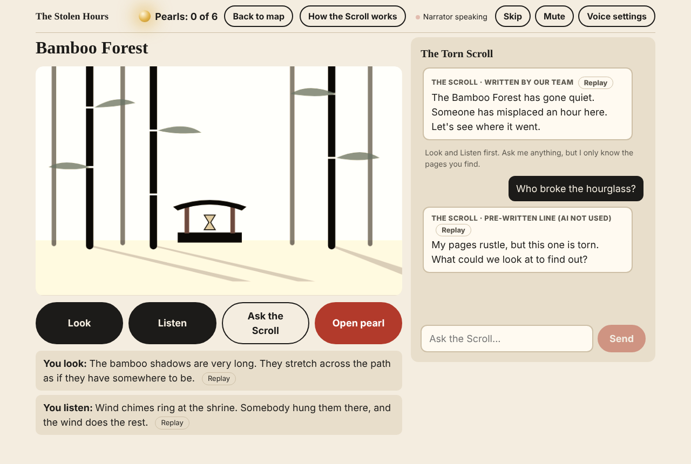
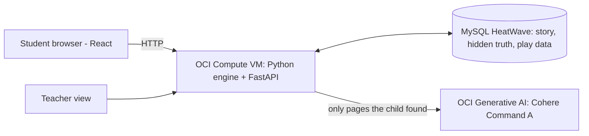

# The Stolen Hours of the Monkey King

**A reasoning adventure for children aged 8 to 13, where the AI narrator cannot cheat for you, and the Monkey King lies to you.**

Demo: `http://<your-public-ip>/` &nbsp;·&nbsp; Teacher view: `http://<your-public-ip>/teacher`



## The problem and our answer

Children now use AI to get answers instead of to think. Our narrator, the Torn Scroll, tells the story out loud in a deep, calm, quietly amused voice, always in 2 or 3 short sentences. It runs on OCI Generative AI but is never told the answer: it only knows the pages the child has found, every reply is checked before a child sees it, and all hints are written by people. The game engine, not the AI, makes every decision, and a teacher view measures reasoning (predictions, sequencing, spotting contradictions, trusting evidence, plus a before/after question) with the number of students behind every figure.

## How to play

1. Type a nickname, answer two quick questions, and watch the 5-line prologue. Grandmother Lin gives you the Torn Scroll.
2. Visit the Bamboo Forest, the East Sea Shore and the Moon Palace Stairs in any order. In each, **Look** and **Listen** before you can **Open a pearl**, and **predict** what each pearl will show before it opens.
3. Read time from shadows, tides and the moon (each pearl has a small picture of its clue; there are no clocks), and put all six Memory Pearls in time order on the **Timeline Board**.
4. Duel Sun Wukong: for each of his three claims, say **Truth** or **Lie**, attach the pearl(s) that prove it, and pick the reason. One claim is true!
5. Name who stole the hours, attach two pearls as proof, read your ending, answer two last questions, and write the next legend.

There are 3 hidden story variants with different culprits, chosen at random when a game starts. A wrong answer never ends the game; it gives a hint and another try.

**The narrator speaks.** Every line appears as a caption first and is then read aloud by the laptop's own speech engine (no extra service). **Skip**, **Mute** and **Voice settings** sit in the top bar, and every line has a **Replay** button. If speech is missing or fails, the game carries on with captions. Built for laptops (Chrome or Edge recommended for the best voices).

## AI / OCI architecture



| Part | What it does |
| --- | --- |
| **OCI Compute VM** | Runs the FastAPI server (`app/`) and serves the web page (`static/`) on port 80. |
| **MySQL HeatWave** | Holds the 6 story tables (including the hidden truth) and 7 play tables (`sql/schema.sql`). |
| **OCI Generative AI** | Writes the Torn Scroll's chat replies and Wukong's taunts (`app/narrator.py`). It never sees the culprit, the true order, or unopened pearls, never writes hints, and every reply passes a safety check (`app/safety.py`). |
| **Game engine** | `app/engine.py`: fixed Python rules that pick the variant, unlock pearls, check the timeline, judge the duel and verdict. Each click is saved completely or not at all (one database transaction), so a failed save never leaves a game stuck. |
| **Narrator voice** | `static/app.js` (Voice): the browser's Web Speech API, preferring deep voices, pitch 0.8, rate 0.88. Story lines are written by the team (`content/story.json`, "narration"); the AI only answers the child's questions. |

> The design doc planned Oracle Autonomous Database. We use **MySQL HeatWave**, which is what our OCI starter kit deployed; the schema is the same tables, translated to MySQL (see the top of `sql/schema.sql`).

## Setup

**Requirements:** Python 3.12, a MySQL HeatWave DB system (or any MySQL 8+), and (optional) an OCI API key with access to Generative AI. Without the AI, the game runs fully on pre-written lines.

```bash
git clone https://github.com/<you>/<repo>.git monkey-king
cd monkey-king
python3.12 -m venv .venv && source .venv/bin/activate
pip install -r requirements.txt
cp .env.example .env        # then edit .env: DB_HOST, DB_PASSWORD, OCI_COMPARTMENT_ID
python scripts/setup_db.py  # creates the database and loads sql/seed.sql, or UPGRADES an older one
uvicorn app.main:app --host 0.0.0.0 --port 8000
```

On the OCI server, `bash deploy/deploy.sh` does all of the above, opens port 80 in the firewall, installs a systemd service so the game restarts by itself, and finishes by playing one whole test game against the live server (`scripts/check_deployment.py`).

**Updating a server that runs an older version:** `git pull && bash deploy/deploy.sh`. `setup_db.py` sees the database's version (`schema_version` table, or its columns for version 1) and upgrades it, keeping player data (`app/migrations.py`). The server refuses to start on a database of the wrong version and says what to run. To start empty instead: `python scripts/setup_db.py --fresh` (asks you to type the database name first).

| Environment variable | Meaning |
| --- | --- |
| `STORE` | `mysql`, `memory`, or `auto` |
| `DB_HOST`, `DB_PORT`, `DB_USER`, `DB_PASSWORD`, `DB_NAME` | MySQL HeatWave connection (private IP, e.g. `10.0.1.185`) |
| `FALLBACK_TO_MEMORY` | `1` = if MySQL is down at startup, keep running from memory |
| `AI_ENABLED` | `0` = never call the AI (pre-written lines only) |
| `OCI_CONFIG_FILE`, `OCI_PROFILE` | The OCI API key config (default `~/.oci/config`, `DEFAULT`) |
| `OCI_COMPARTMENT_ID` | Compartment allowed to use Generative AI (tenancy OCID works on a trial) |
| `OCI_GENAI_ENDPOINT`, `OCI_GENAI_MODEL` | Region endpoint and model id (default Chicago, `cohere.command-a-03-2025`) |
| `AI_TIMEOUT_S` | Seconds before a pre-written line is used instead (default 6) |
| `TEACHER_CODE` | Optional passcode for `/teacher`, so students can't open it (empty = open) |

**Is it really working?** From any laptop: `python scripts/check_deployment.py http://<public-ip> --play` checks health, the database (MySQL, right version), a real AI call, every page, and plays one whole game over HTTP, printing PASS/FAIL per check. `curl http://127.0.0.1/api/health?check_ai=1` makes one real AI call; `ai_configured` alone only means the settings exist. Health answers 503 if the database is down or on the wrong version.

**Changing the story:** edit `content/story.json`, run `python scripts/build_seed.py`, then `python scripts/setup_db.py`, and restart the server. New myths are data, not code.

**Tests:** `pip install -r requirements-dev.txt && python -m pytest -q` (201 pass, 151 skipped). On the server, `bash scripts/test_on_server.sh` runs all of them against the real MySQL HeatWave from `.env` (352 pass, none skipped), using separate test databases, never the game's. They include saves that fail half-way and are retried, two simultaneous clicks, and upgrading a real version-1 database. `python tests/browser_playthrough.py http://127.0.0.1:8000` plays the whole game in Chromium and checks what the narrator says (voice, 2-3 sentences, each line once, Mute/Skip/Replay), plus two shorter runs where speech fails or is missing.

**Playtests and interviews:** see `docs/validation.md`.

## Responsible AI

- **Synthetic or public data only:** the story is ours; the myths are public domain. No real student data.
- **AI is labelled:** every Scroll and Wukong line says where it came from: "AI narrator" when the AI wrote it, "written by our team", or "pre-written line (AI not used)".
- **What informs the AI is explained:** the "How the Scroll works" button.
- **Learners keep decision authority:** the child makes every prediction, order, duel answer and verdict. The engine checks them; the AI cannot.
- **Privacy:** nickname only (no email, age, location or login). The teacher view shows class totals only.
- **The AI is never given the answer:** the culprit, the true order and the duel answers are never sent to it, and all hints come from a table written by people.
- **Every AI reply is checked before a child sees it:** a reply that is unkind, names a culprit, links any suspect or sign to the theft, states an order, says whether a claim is true, tells the child what to select/choose/pick, repeats an answer choice of a question the child has not answered yet, or is not 2-3 sentences is replaced with a pre-written line. No word filter is perfect, which is why the AI never has the answers and never decides anything.
- **Input filters:** questions are cut to 200 characters; rude words and "ignore your instructions" tricks are stopped before the AI call. If the AI fails or takes over 6 seconds, a pre-written line is used.
- **Hidden ids:** the browser only sees random per-game pearl codes, so nothing in the page or the network traffic reveals the order.
- **Fairness:** no character is evil, and the obvious suspect (Wukong) is the culprit in only 1 of 3 variants.

## Image credits

All pictures (`static/img/*.svg`) are original drawings made in code for this project. No photos, prints, or game art were used. React and htm are included in `static/vendor/` under their MIT licenses.

## Team

| Person | Role |
| --- | --- |
| Tarik | Integration: React pages, HTTP API, engine handlers |
| Taseen | Persistence and world: story content in the database, variant per session, per-session state |
| Siddiq | AI module: Scroll and Wukong prompts, fallbacks, pitch and README |
